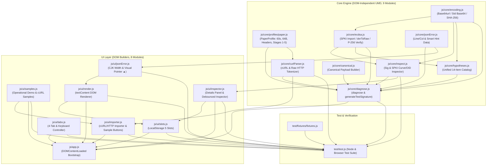
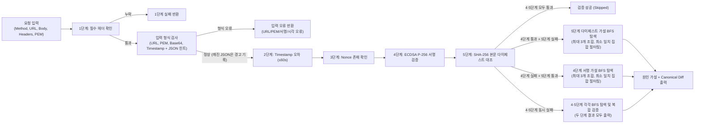

# PoP Diagnoser (Proof of Possession 게이트웨이 401/403/400 오프라인 진단기)

[](https://github.com/altdmfk/pop-diagnoser/actions/workflows/test.yml)

> **FIDO2 PoP 게이트웨이의 `401`/`403`/`400` 거절 원인을 5단계 검증 파이프라인과 14개 가설 BFS 탐색으로 역추적하는 무의존성·오프라인 진단기**  
> **Zero-dependency offline diagnostic tool that pinpoints FIDO2 Proof-of-Possession (`401`/`403`/`400`) signature and digest failures via 5-stage verification and 14-hypothesis BFS search.**

---

## 1. 문제 정의

보안 게이트웨이는 공격자에게 단서를 주지 않기 위해 서명 검증에 실패해도 `401 Unauthorized`, `403 Forbidden`, `400 Bad Request`만 반환합니다.  
그래서 연동 과정에서 다음과 같은 차이가 생기면 어디서 문제가 발생했는지 확인하기가 쉽지 않습니다.

- 쿼리 파라미터(`?c=3&a=1&b=2`)를 서명 전에 알파벳순으로 정렬했는가, 원본 순서를 유지했는가?
- HTTP 메서드를 소문자(`post`)로 서명했거나, 프록시가 `Host` 헤더의 `:443` 포트를 제거했는가?
- ECDSA P-256 서명을 IEEE P1363(64바이트 Raw `r || s`) 대신 ASN.1 DER 형식이나 표준 Base64(`+`, `/`, `=`)로 인코딩했는가?
- 본문(Body) 해시 계산 시 줄바꿈이 `CRLF(\r\n)`로 바뀌었거나 대문자 Hex / Base64url을 사용했는가?

**PoP Diagnoser**는 게이트웨이의 1~5단계 검증 과정을 브라우저와 CLI에서 동일하게 재현합니다. 검증에 실패하면 14개 항목의 가설 카탈로그를 너비 우선 탐색(BFS)으로 조합해, 클라이언트가 실제로 서명한 문자열과 게이트웨이가 기대한 정규화 문자열의 차이를 비교해 보여줍니다.

---

## 2. 데모 및 실행 방법

- **라이브 데모 (GitHub Pages):** [https://altdmfk.github.io/pop-diagnoser/](https://altdmfk.github.io/pop-diagnoser/)
- **관련 게이트웨이 및 논문 프로젝트:** [FIDO2 PoP Gateway Project (`https://altdmfk.github.io/fido2-pop-gateway/`)](https://altdmfk.github.io/fido2-pop-gateway/)

### 로컬 실행 (`file://` 지원)
1. 저장소를 클론하거나 ZIP으로 내려받습니다.
2. 별도의 패키지 설치나 로컬 웹 서버 없이 [`index.html`](index.html) 파일을 브라우저(`file://`)에서 바로 엽니다.
3. 브라우저 개발자 도구(F12)의 **Network** 탭을 열어두면 외부 네트워크 요청이 발생하지 않는 것을 확인할 수 있습니다.

---

## 3. 주요 기능

- **5단계 오프라인 검증 파이프라인**: 필수 헤더 확인(1단계) → 타임스탬프 허용 오차 60초(2단계) → Nonce 존재 여부(3단계) → ECDSA P-256 서명 검증(4단계) → 본문 SHA-256 다이제스트 대조(5단계) 순서로 진단합니다. 본문은 JSON에 한정하지 않으며 평문(`"hello"`), 빈 본문, `form-urlencoded` 등 임의의 바이트 스트림을 그대로 해시합니다.
- **최소 일치 집합(Minimal Matching Set) 가설 탐색 및 Diff 표시**: 4단계 서명 검증 실패 및 5단계 다이제스트 불일치 시 각각 최대 3개 복합 실수(`maxComboDepth: 3`)까지 BFS로 탐색하고(4·5단계 동시 실패 시 두 단계의 원인을 모두 탐색·표시), 불필요한 상위 집합을 제외한 최소 원인 조합과 줄 단위 Canonical Payload Diff(`- 클라이언트 서명값` / `+ 게이트웨이 기대값`)를 출력합니다.
- **cURL / Raw HTTP 붙여넣기 파서 및 샘플 명령어**: 브라우저 개발자 도구의 `Copy as cURL (bash)` 명령어나 Raw HTTP 요청 원문을 붙여넣어 메서드, URL, 본문(공백·들여쓰기 및 cURL `$'...\r\n...'` 이스케이프·클립보드 원본 CRLF 보존 — 단, 브라우저 `<textarea>`에 직접 입력된 일반 줄바꿈은 HTML 표준에 따라 `LF(\n)`로 정규화되며 UI에 안내 표시), PoP 헤더 4종을 한 번에 채울 수 있습니다. 바로 시험해 볼 수 있도록 `샘플: 정상 cURL`, `샘플: 실패 cURL (DER 서명)`, `샘플: Raw HTTP` 버튼 3종을 제공하며, 기존 입력값이 있을 때는 덮어쓰기 전에 확인 바를 띄웁니다.
- **서명 · 공개키 구조 인스펙터**: 서명의 인코딩(`base64url` / 표준 `base64` / `hex`), 바이트 길이, 형식(`raw-rs(64B)` / `der`), `r`·`s` 32B Hex, `s > n/2` (High-S) 여부를 분석합니다. 공개키는 SPKI OID(`ecPublicKey` / `P-256`), 비압축 좌표(`0x04 || X || Y`), P-256 타원곡선 방정식(\(y^2 \equiv x^3 - 3x + b \pmod p\)) 충족 여부, SHA-256 Fingerprint를 확인하며, 실수로 개인키(`PRIVATE KEY`) PEM을 입력하면 메인 진단기와 인스펙터 모두 파싱하지 않고 즉시 거부(`PRIVATE_KEY_REJECTED`)합니다.
- **내장 테스트 서명 생성기**: 브라우저 WebCrypto API(`crypto.subtle`)를 사용해 현재 입력된 요청에 대한 임시 ECDSA P-256 키 쌍(`extractable: false`), `X-Body-Digest`, 전자서명을 생성합니다.
- **JSON 문법 오류 위치 표시**: 요청 본문(Body)이 JSON 형태(`{`, `[` 또는 JSON 구문 토큰 포함)이면서 문법 오류가 있을 때 진단을 중단하지 않고 경고(`warnings`)로 기록하며, 5단계 다이제스트 불일치 시 한글·전각 문자 폭(2칸)과 탭을 보정한 오류 위치 화살표(`▲`)와 원인 힌트를 함께 표시합니다.
- **4개 탭 레이아웃 · 키보드 접근성 · 5개 슬롯 저장소**: 입력과 보조 도구를 `HTTP 요청` / `서명 헤더` / `검증 설정` / `cURL · 임시저장소` 4개 탭으로 나누고, 좌우 방향키·`Home`·`End` 키 이동과 ARIA 속성을 지원합니다. `localStorage` 기반 슬롯 5개에 전체 입력 상태를 저장하고 불러올 수 있습니다.

---

## 4. 설계 원칙

1. **외부 네트워크 요청 0건**
   - `fetch`, `XMLHttpRequest`, `WebSocket`, `sendBeacon`, 외부 폰트·스크립트를 사용하지 않으며, CSP `connect-src 'none'`으로 외부 연결을 막았습니다.
2. **비밀키 비요구 및 비추출**
   - 진단기는 공개키(SPKI PEM/Base64)와 서명 결과값만 입력받으며, `PRIVATE KEY` PEM 입력은 즉시 거부합니다. 내장 테스트 서명 생성기도 `extractable: false`로 임시 키를 생성해 비밀키가 메모리 밖으로 추출되지 않습니다.
3. **CSP 준수 및 DOM 기반 렌더링**
   - `default-src 'none'; script-src 'self' file:; style-src 'self' file:;` 정책을 적용합니다.
   - 코드 전체에서 `innerHTML`, `outerHTML`, `eval`, `new Function`, 인라인 이벤트 핸들러(`onclick=`), 인라인 스타일 조작(`el.style.*`)을 사용하지 않습니다. 코어 모듈은 데이터 객체만 반환하고, UI 모듈은 `createElement`와 `textContent`로만 화면을 그립니다.
4. **무빌드 UMD 모듈 구조**
   - `file://` 환경에서는 브라우저 CORS 정책 때문에 ES 모듈(`<script type="module">`)이 동작하지 않습니다. 모든 스크립트를 UMD 패턴으로 작성해 빌드 도구 없이 브라우저(`window.PopCore`, `window.PopUI`)와 Node.js(`require()`) 양쪽에서 그대로 실행됩니다.

---

## 5. 아키텍처

### 5.1 모듈 구조도 (`core` / `profile` / `ui` / `test`)



### 5.2 진단 5단계 및 가설 탐색 흐름도



---

## 6. 가설 카탈로그

4단계(서명 검증) 또는 5단계(다이제스트 대조) 실패 시 탐색하는 가설 목록입니다. 모든 가설은 [`js/core/hypotheses.js`](js/core/hypotheses.js)에 단일 스키마(`{ id, label, tag, stage, apply }`)로 정의되어 있으며 [`test/test.js`](test/test.js)에서 각 항목을 테스트합니다.

| # | 가설 ID (`id`) | 출처 태그 | 적용 단계 | 진단하는 실수 내용 | 테스트 검증 위치 |
| :-: | :--- | :--- | :-: | :--- | :--- |
| 1 | `query-sorted` | `[흔한 실수]` | 4단계 | 쿼리 파라미터를 알파벳순으로 정렬하여 서명함 | [`fixtures.js`](test/fixtures/fixtures.js) (`query-sorted`, `combo-2`, `combo-2-2`) |
| 2 | `query-reverse` | `[흔한 실수]` | 4단계 | 쿼리 파라미터 순서를 역순으로 뒤집어 서명함 | [`test/test.js`](test/test.js) (`hyp-query-reverse`) |
| 3 | `method-lowercase` | `[흔한 실수]` | 4단계 | HTTP 메서드를 소문자(`post`, `get` 등)로 서명함 | [`fixtures.js`](test/fixtures/fixtures.js) (`method-lowercase`, `combo-2`) |
| 4 | `path-trailing-slash-add` | `[흔한 실수]` | 4단계 | URL Path 끝에 슬래시(`/`)를 추가하여 서명함 | [`fixtures.js`](test/fixtures/fixtures.js) (`path-trailing-slash-add`) |
| 5 | `path-trailing-slash-remove` | `[흔한 실수]` | 4단계 | URL Path 끝의 슬래시(`/`)를 제거하고 서명함 | [`test/test.js`](test/test.js) (`hyp-path-trailing-slash-remove`) |
| 6 | `host-rewritten` | `[흔한 실수]` | 4단계 | 일반 호스트(도메인·IPv4)에서 `Host`의 기본 포트(`:443`) 유무를 토글하여 누락·추가를 양방향 탐지함 | [`fixtures.js`](test/fixtures/fixtures.js) (`host-rewritten`, `both-fail`), [`test/test.js`](test/test.js) (`host-rewritten-port-and-ipv6`) |
| 7 | `sig-der` | `[인코딩]` | 4단계 | 서명을 64B Raw(P1363) 대신 ASN.1 DER 형식으로 인코딩함 | [`fixtures.js`](test/fixtures/fixtures.js) (`sig-der`), [`test/test.js`](test/test.js) (`hyp-sig-der-short-under-70b`) |
| 8 | `sig-base64url` | `[인코딩]` | 4단계 | 서명을 Base64url 대신 표준 Base64(`+`, `/`, `=`)로 인코딩함 | [`test/test.js`](test/test.js) (`hyp-sig-base64url`) |
| 9 | `newline-crlf` | `[논문 규칙]` | 4·5단계 겸용 | Canonical 구분자(4단계)에 `CRLF(\r\n)`를 사용했거나 본문 줄바꿈(5단계)이 `LF` ↔ `CRLF`로 달라진 경우를 양방향 탐지함 | [`test/test.js`](test/test.js) (`hyp-newline-crlf-stage4`, `newline-crlf-bidirectional`), [`fixtures.js`](test/fixtures/fixtures.js) (`newline-crlf`, `combo-2-2`) |
| 10 | `newline-trailing` | `[논문 규칙]` | 4·5단계 겸용 | Canonical 문자열(4단계) 또는 본문(5단계) 끝에 줄바꿈(`\n`)을 추가함 | [`test/test.js`](test/test.js) (`hyp-newline-trailing-stage4`, `hyp-newline-trailing-stage5`) |
| 11 | `digest-base64url` | `[인코딩]` | 5단계 | 본문 SHA-256 해시를 소문자 Hex 대신 Base64url로 인코딩함 | [`fixtures.js`](test/fixtures/fixtures.js) (`digest-base64url`) |
| 12 | `digest-hex` | `[인코딩]` | 5단계 | 본문 SHA-256 해시를 대문자(또는 대소문자 혼합) Hex로 인코딩함 | [`test/test.js`](test/test.js) (`hyp-digest-hex`) |
| 13 | `body-bom-added` | `[흔한 실수]` | 5단계 | 본문 앞에 UTF-8 BOM(`\uFEFF`)이 추가된 상태로 해시를 계산함 | [`test/test.js`](test/test.js) (`hyp-body-bom-added`) |
| 14 | `body-reserialized-nospace` | `[흔한 실수]` | 5단계 | 원본 본문 대신 `JSON.stringify()`로 공백을 제거한 문자열을 해시함 | [`test/test.js`](test/test.js) (`hyp-body-reserialized-nospace`) |

---

## 7. 테스트, 검증 도구 및 배포 안내

### CI 자동 검증 및 단위·회귀 테스트 실행 ([`.github/workflows/test.yml`](.github/workflows/test.yml))
Node.js(v20 이상 권장) 및 Python 3 환경에서 외부 패키지 설치 없이 실행되며, GitHub Actions CI에서 매 푸시/PR마다 아래 3가지 검증이 자동으로 수행됩니다.
```bash
# 1. 단위·통합·회귀 테스트 스위트 실행 (고정 벡터·가설 카탈로그·인스펙터·파서·UI·XSS·정적 검사)
node test.js
node test/test.js

# 2. 골든 패스 픽스처 전 단계(1~5단계) 통과 검증
node tools/golden_pass.js

# 3. 인코딩 무결성 검사 (UTF-8, BOM 미포함, U+FFFD 깨진 문자 여부 확인, 이상 시 exit 1)
python tools/check_encoding.py
```
브라우저에서 확인하려면 [`test.html`](test.html) 파일을 열어 동일한 테스트 스위트를 실행할 수 있습니다. 브라우저 환경에서는 Node.js `fs` 모듈이 필요한 정적 파일 검사 항목만 `Skipped`로 별도 집계하여(`Passed` + `Failed` + `Skipped` = `Total`) Node.js와 동일한 전체 테스트 수를 유지합니다.

### 픽스처 생성 및 게이트웨이 차분 테스트 (로컬 참조 저장소 연동 시 선택 실행)
로컬 상위 경로에 참조 게이트웨이 저장소(`../fido2-pop-gateway-main`)와 Python 가상환경(`cryptography`, `fastapi` 등)이 준비된 경우, FastAPI 게이트웨이의 실제 응답과 진단기의 판정 단계를 1:1로 비교하고 픽스처를 재생성할 수 있습니다.
```bash
python tools/generate_fixtures.py    # 14개 시나리오 생성 및 test/fixtures/fixtures.js 갱신
python tools/differential_check.py   # 게이트웨이 vs 진단기 14개 시나리오 단일 Node 호출 차분 검증
```

### GitHub Pages 정적 배포 안내
루트 [`index.html`](index.html)과 상대 경로 리소스만으로 구성되어 있어 별도 빌드 과정 없이 GitHub Pages로 배포할 수 있습니다.
1. GitHub 저장소의 **Settings → Pages** 메뉴로 이동합니다.
2. **Build and deployment**의 **Source**를 `Deploy from a branch`로 선택합니다.
3. **Branch**를 `main`, 폴더를 `/ (root)`로 선택한 뒤 **Save**를 누릅니다.
4. 배포가 끝나면 `https://<OWNER>.github.io/<REPO>/`에서 사용할 수 있습니다.

---

## 8. 알려진 한계

- **카탈로그 밖 변형 및 복합 오류 상한**: 브라우저 응답 지연을 막기 위해 가설 탐색은 최대 3개 조합(`maxComboDepth: 3`), 최대 100회 서명 검증 호출(`maxSearchNodes: 100`, 순열·상태 중복 제거 후 현재 4단계 가설 10개 기준 일반 최악 입력 시 63회·64B DER 특수 입력 포함 시 최대 92회 `verifySig` 호출)까지만 수행합니다. 카탈로그에 없는 변형이나 4개 이상의 복합 실수는 `"원인 파악 실패 (일치하는 실수 패턴 없음)"`으로 표시됩니다.
- **`host-rewritten` 가설의 범위**: 입력 URL 원문의 Authority 구간에 `:443`이 명시된 경우 이를 `baseReq.host`에 보존하며, `host-rewritten` 가설은 일반 호스트(도메인·IPv4)에서 HTTPS 기본 포트(`:443`)의 유무를 토글(제거·추가 양방향)만 수행합니다. IPv6 호스트(예: `[::1]`, `[::1]:8443`), 커스텀 포트(예: `:8443`), `:80` 포트는 변형하거나 탐지하지 않으며, 브라우저 `new URL()` 파서가 자동으로 소문자로 바꾸는 `Host` 대소문자 차이도 탐지하지 않습니다.
- **프록시·중간 계층의 요청 변형**: 리버스 프록시, CDN, WAF 등이 전송 도중 URL이나 본문을 수정한 경우, 클라이언트가 서명한 원본 값을 찾으려면 변형 전후의 요청을 함께 비교해야 합니다.
- **서버 상태 의존 항목 제외**: 게이트웨이 DB의 Nonce 재사용(Replay) 여부 조회와 `Authorization` 헤더의 JWT 클레임(`cnf.kid`) 바인딩 검증은 서버 상태가 필요하므로 오프라인 진단 범위에서 제외됩니다.

---

## 9. 논문과의 관계 및 케이스 스터디

- **기반 논문 및 게이트웨이**: 이 도구는 [**"Design and Performance Analysis of a FIDO2 Hardware-Isolated Key-Based Proof-of-Possession Reverse Proxy Gateway"**](https://altdmfk.github.io/fido2-pop-gateway/)의 정규화 규격(`PaperProfile`)을 따릅니다.
- **논문 순서 vs 실제 게이트웨이 구현 순서**: 논문 개념도는 4단계 다이제스트 대조 후 5단계 서명 검증을 설명하지만, 실제 게이트웨이 코드는 대용량 본문 해시 연산을 이용한 서비스 거부(DoS) 공격을 막기 위해 **헤더 기반의 ECDSA 서명 검증(4단계)을 먼저 수행한 뒤 본문 스트리밍 다이제스트 대조(5단계)**를 수행합니다. 진단기는 실제 게이트웨이 코드의 실행 순서를 따릅니다.
- **코드 감사 및 리팩토링 기록**: 코드 감사 과정에서 찾아 수정한 도달 불가 가설, DOM XSS, DER 파서 경계 버그와 추가 기능 설계 내용은 [**`docs/case-study.md`**](docs/case-study.md)에 정리되어 있습니다.
