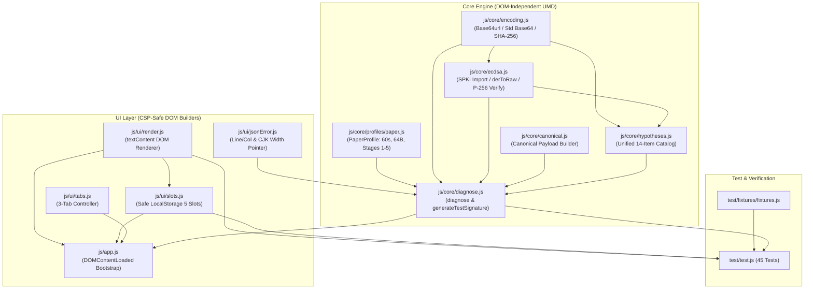
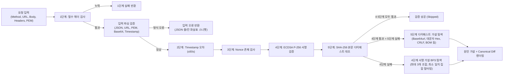

# PoP Diagnoser (Proof of Possession 게이트웨이 401/403/400 오프라인 진단기)

[](https://github.com/altdmfk/pop-diagnoser/actions/workflows/test.yml)

> **한 줄 요약 (KR):** FIDO2 Proof-of-Possession(PoP) 게이트웨이가 `401`/`403`/`400`을 반환할 때, 외부 네트워크 통신이나 비밀키 노출 없이 **어느 검증 단계에서 어떤 정규화/인코딩 실수로 실패했는지** 역추적하는 무빌드 오프라인 진단 샌드박스입니다.  
> **Summary (EN):** A zero-dependency, offline browser/CLI diagnostic sandbox that pinpoints the exact verification failure stage and canonicalization/encoding mistake (via BFS minimal matching set search) when a FIDO2 Proof-of-Possession API gateway rejects requests with `401`/`403`/`400`.

---

## 1. 문제 정의 (Problem Statement)

보안 게이트웨이는 공격자에게 오라클(Oracle) 정보를 주지 않기 위해 서명 검증 실패 시 단순히 `401 Unauthorized`, `403 Forbidden`, 또는 `400 Bad Request`만 반환합니다.  
하지만 연동 개발자 입장에서는 다음과 같은 미묘한 차이 중 어디서 문제가 발생했는지 파악하기 매우 어렵습니다.

- 쿼리 파라미터(`?c=3&a=1&b=2`)를 서명 전에 알파벳순으로 정렬했는가, 원본 순서를 유지했는가?
- HTTP 메서드를 소문자(`post`)로 서명했거나, 프록시가 `Host` 헤더의 `:443` 포트를 제거했는가?
- ECDSA P-256 서명을 IEEE P1363(64바이트 Raw `r || s`) 대신 ASN.1 DER 포맷이나 표준 Base64(`+`, `/`, `=`)로 인코딩했는가?
- 본문(Body) 해시 계산 시 줄바꿈이 `CRLF(\r\n)`로 변환되었거나 대문자 Hex / Base64url을 사용했는가?

**PoP Diagnoser**는 게이트웨이의 1~5단계 검증 파이프라인을 로컬에서 그대로 재현하고, 검증 실패 시 **13종의 실수 가설 카탈로그를 조합 탐색(BFS)**하여 "클라이언트가 실제로 서명한 문자열"과 "게이트웨이가 기대한 정규화 문자열"의 차이를 즉시 시각화합니다.

---

## 2. 데모 및 실행 방법 (Demo & Quick Start)

- **라이브 데모 (GitHub Pages):** [https://altdmfk.github.io/pop-diagnoser/](https://altdmfk.github.io/pop-diagnoser/)
- **관련 게이트웨이 및 논문 프로젝트:** [FIDO2 PoP Gateway Project (`https://altdmfk.github.io/fido2-pop-gateway/`)](https://altdmfk.github.io/fido2-pop-gateway/)

### 로컬 즉시 실행 (`file://` 지원)
1. 저장소를 클론하거나 ZIP으로 내려받습니다.
2. 별도의 빌드 도구(`npm install`, 번들러, 로컬 웹 서버) 없이 **`index.html` 파일을 더블클릭**하여 브라우저(`file://`)에서 바로 엽니다.
3. 브라우저 개발자 도구(F12)의 **Network** 탭을 열어둔 채로 진단을 실행해 보세요. 외부 네트워크 요청이 **0건**임을 직접 확인할 수 있습니다.

---

## 3. 주요 기능 (Key Features)

- **5단계 오프라인 검증 파이프라인**: 필수 헤더 서식(1단계) → 타임스탬프 허용 오차 60초(2단계) → Nonce 존재 여부(3단계) → ECDSA P-256 서명 수학 검증(4단계) → 본문 SHA-256 다이제스트 스트리밍 대조(5단계)를 순차 진단합니다.
- **최소 일치 집합(Minimal Matching Set) 가설 탐색 및 Diff 시각화**: 4단계 서명 실패 시 최대 3개 복합 실수(`maxComboDepth: 3`)까지 BFS로 탐색하고, 상위 집합(Superset)을 제거한 최소 원인 집합과 줄 단위 Canonical Payload Diff(`- 클라이언트 서명값` / `+ 게이트웨이 기대값`)를 제시합니다.
- **내장 테스트 서명 생성기**: 브라우저 내장 WebCrypto API(`crypto.subtle`)를 사용해 현재 입력된 요청에 대한 임시 ECDSA P-256 키 쌍, `X-Body-Digest`, 전자서명을 즉석에서 생성해 볼 수 있습니다.
- **정밀한 JSON 문법 오류 위치 시각화**: 요청 본문(Body) JSON 파싱 실패 시 오류 발생 줄/칸 번호를 계산하고, 한글·CJK 전각 문자 폭(2칸)과 탭을 보정하여 정확한 위치 아래에 화살표(`▲`)를 표시합니다.
- **3개 탭 레이아웃 & 5개 다중 슬롯 임시저장소**: 입력 항목을 `HTTP 요청` / `서명 헤더` / `검증 설정` 탭으로 구조화하고, `localStorage` 기반 5개 슬롯으로 실험 케이스를 안전하게 저장·복원합니다(`localStorage` 차단 환경에서도 앱이 중단되지 않도록 예외 방어 적용).

---

## 4. 보안 및 설계 원칙 (Design Principles)

1. **외부 네트워크 요청 0건 (Zero Network Traffic)**
   - `fetch`, `XMLHttpRequest`, `WebSocket`, `sendBeacon`, 외부 CDN 폰트/스크립트/이미지를 일체 사용하지 않으며, CSP `connect-src 'none'`으로 브라우저 수준에서 네트워크 연결을 차단합니다.
2. **비밀키(Private Key) 비요구**
   - 진단기는 오직 **공개키(SPKI PEM/Base64)**와 **서명 결과값**만 입력받아 검증합니다. 클라이언트의 비공개키를 요구하거나 외부로 반출하지 않습니다.
3. **엄격한 CSP 및 DOM XSS 원천 차단**
   - `default-src 'none'; script-src 'self' file:; style-src 'self' file:;` 정책을 적용합니다.
   - 코드베이스 전체에서 `innerHTML`, `outerHTML`, `eval`, `new Function`, 인라인 이벤트 핸들러(`onclick=`), 인라인 스타일 조작(`el.style.*`)이 **0건**입니다. 모든 에러/경고/결과는 코어에서 순수 데이터 객체로 반환되고 UI에서 `createElement`와 `textContent`로만 렌더링됩니다.
4. **무빌드·무런타임 의존성 (No Build, No Dependencies)**
   - `file://` 환경에서는 CORS 정책으로 인해 `<script type="module">`이 차단됩니다. 이를 해결하기 위해 모든 모듈을 **UMD(Universal Module Definition)** 패턴으로 설계하여 브라우저(`window.PopCore`, `window.PopUI`)와 Node.js(`require()`) 양쪽에서 빌드 과정 없이 동일하게 동작합니다.

---

## 5. 아키텍처 (Architecture)

### 5.1 모듈 구조도 (`core` / `profile` / `ui` / `test`)



### 5.2 진단 5단계 및 가설 탐색 흐름도



---

## 6. 가설 카탈로그 (Hypothesis Catalog)

4단계(서명 검증) 또는 5단계(다이제스트 대조) 실패 시 탐색하는 전체 가설 목록입니다. 모든 가설은 [`js/core/hypotheses.js`](js/core/hypotheses.js)에 단일 스키마(`{ id, label, tag, stage, apply }`)로 정의되어 있으며 [`test/test.js`](test/test.js)에서 전수 검증됩니다.

| # | 가설 ID (`id`) | 출처 태그 | 적용 단계 | 진단하는 실수 내용 | 테스트 검증 위치 |
| :-: | :--- | :--- | :-: | :--- | :--- |
| 1 | `query-sorted` | `[흔한 실수]` | 4단계 | 쿼리 파라미터를 알파벳순으로 정렬하여 서명함 | [`fixtures.js`](test/fixtures/fixtures.js) (`query-sorted`, `combo-2`) |
| 2 | `query-reverse` | `[흔한 실수]` | 4단계 | 쿼리 파라미터 순서를 역순으로 뒤집어 서명함 | [`test/test.js`](test/test.js) (`hyp-query-reverse`) |
| 3 | `method-lowercase` | `[흔한 실수]` | 4단계 | HTTP 메서드를 소문자(`post`, `get` 등)로 서명함 | [`fixtures.js`](test/fixtures/fixtures.js) (`method-lowercase`, `combo-2`) |
| 4 | `path-trailing-slash-add` | `[흔한 실수]` | 4단계 | URL Path 끝에 슬래시(`/`)를 추가하여 서명함 | [`fixtures.js`](test/fixtures/fixtures.js) (`path-trailing-slash-add`) |
| 5 | `path-trailing-slash-remove` | `[흔한 실수]` | 4단계 | URL Path 끝의 슬래시(`/`)를 제거하고 서명함 | [`test/test.js`](test/test.js) (`hyp-path-trailing-slash-remove`) |
| 6 | `host-rewritten` | `[흔한 실수]` | 4단계 | 프록시/클라이언트가 `Host`의 포트(`:443`)를 추가하거나 제거함 | [`fixtures.js`](test/fixtures/fixtures.js) (`host-rewritten`, `both-fail`) |
| 7 | `sig-der` | `[인코딩]` | 4단계 | 서명을 64B Raw(P1363) 대신 ASN.1 DER 형식으로 인코딩함 | [`fixtures.js`](test/fixtures/fixtures.js) (`sig-der`), [`test/test.js`](test/test.js) (`hyp-sig-der-short-under-70b`) |
| 8 | `sig-base64url` | `[인코딩]` | 4단계 | 서명을 Base64url 대신 표준 Base64(`+`, `/`, `=`)로 인코딩함 | [`test/test.js`](test/test.js) (`hyp-sig-base64url`) |
| 9 | `newline-crlf` | `[논문 규칙]` | 4·5단계 겸용 | Canonical 구분자(4단계) 또는 본문 줄바꿈(5단계)을 `CRLF(\r\n)`로 사용함 | [`test/test.js`](test/test.js) (`hyp-newline-crlf-stage4`), [`fixtures.js`](test/fixtures/fixtures.js) (`newline-crlf`) |
| 10 | `newline-trailing` | `[논문 규칙]` | 4·5단계 겸용 | Canonical 문자열(4단계) 또는 본문(5단계) 끝에 줄바꿈(`\n`)을 추가함 | [`test/test.js`](test/test.js) (`hyp-newline-trailing-stage4`, `hyp-newline-trailing-stage5`) |
| 11 | `digest-base64url` | `[인코딩]` | 5단계 | 본문 SHA-256 해시를 소문자 Hex 대신 Base64url로 인코딩함 | [`fixtures.js`](test/fixtures/fixtures.js) (`digest-base64url`) |
| 12 | `digest-hex` | `[인코딩]` | 5단계 | 본문 SHA-256 해시를 대문자(또는 대소문자 혼합) Hex로 인코딩함 | [`test/test.js`](test/test.js) (`hyp-digest-hex`) |
| 13 | `body-bom-added` | `[흔한 실수]` | 5단계 | 본문 앞에 UTF-8 BOM(`\uFEFF`)이 추가된 상태로 해시를 계산함 | [`test/test.js`](test/test.js) (`hyp-body-bom-added`) |
| 14 | `body-reserialized-nospace` | `[흔한 실수]` | 5단계 | 원본 본문 대신 `JSON.stringify()`로 공백을 제거한 문자열을 해시함 | [`test/test.js`](test/test.js) (`hyp-body-reserialized-nospace`) |

---

## 7. 테스트, 검증 도구 및 배포 안내 (Testing & Deployment)

### 단위·회귀 테스트 실행
Node.js(v20 이상 권장) 환경에서 외부 패키지 설치 없이 즉시 실행됩니다.
```bash
# 루트 진입점 또는 테스트 파일 직접 실행 (총 45개 테스트)
node test.js
node test/test.js

# 인코딩 무결성 검사 (Strict UTF-8, BOM 미포함, U+FFFD 깨진 문자 검사)
python tools/check_encoding.py
```
브라우저에서 확인하려면 `test.html` 파일을 더블클릭(`file://`)으로 열면 동일한 테스트가 실행됩니다.

### 픽스처 생성 및 게이트웨이 차분 테스트 (선택)
로컬에 참조 게이트웨이 저장소(`../fido2-pop-gateway-main`)가 있는 경우, 실제 FastAPI 게이트웨이의 응답과 본 진단기의 판정 단계를 대조(Differential Testing)할 수 있습니다.
```bash
python tools/generate_fixtures.py    # test/fixtures/fixtures.js 갱신
python tools/differential_check.py   # 게이트웨이 vs 진단기 14개 시나리오 차분 검증
node tools/golden_pass.js            # 골든 패스 픽스처 검증
```

### GitHub Pages 정적 배포 안내
본 프로젝트는 루트 [`index.html`](index.html)과 상대 경로 리소스만으로 구성되어 있어 별도 빌드 워크플로 없이 GitHub Pages로 즉시 배포할 수 있습니다.
1. GitHub 저장소의 **Settings → Pages** 메뉴로 이동합니다.
2. **Build and deployment**의 **Source**를 `Deploy from a branch`로 선택합니다.
3. **Branch**를 `main`, 폴더를 `/ (root)`로 선택한 뒤 **Save**를 누릅니다.
4. 배포 완료 후 `https://<OWNER>.github.io/<REPO>/`에서 오프라인 진단기와 완전히 동일한 기능을 사용할 수 있습니다.

---

## 8. 알려진 한계 (Known Limitations)

- **카탈로그 밖 변형 및 복합 오류 상한**: 브라우저 응답성을 보장하기 위해 가설 탐색은 최대 3개 조합(`maxComboDepth: 3`), 최대 2,000개 노드(`maxSearchNodes: 2000`)까지만 수행합니다. 카탈로그에 없는 독자적 변형이나 4개 이상의 복합 실수는 `"원인 파악 실패 (일치하는 실수 패턴 없음)"`으로 표시됩니다.
- **중간 계층 은밀한 변형**: 리버스 프록시, CDN, WAF 등이 전송 도중 URL이나 본문을 재작성한 경우 클라이언트가 서명한 원본 값을 역추적하려면 변형 전후 요청을 비교해야 합니다.
- **서버 상태 의존 항목 제외**: 게이트웨이 DB의 Nonce 재사용(Replay) 여부 조회 및 `Authorization` 헤더의 JWT 클레임(`cnf.kid`) 바인딩 검증은 서버 상태가 필요하므로 오프라인 진단 범위에서 제외됩니다.

---

## 9. 논문과의 관계 및 케이스 스터디 (Paper & Case Study)

- **기반 논문 및 게이트웨이**: 본 도구는 [**"Design and Performance Analysis of a FIDO2 Hardware-Isolated Key-Based Proof-of-Possession Reverse Proxy Gateway"**](https://altdmfk.github.io/fido2-pop-gateway/)의 정규화 규격(`PaperProfile`)을 따릅니다.
- **논문 순서 vs 실제 게이트웨이 구현 순서**: 논문 개념도는 4단계 다이제스트 대조 후 5단계 서명 검증을 설명하나, 실제 게이트웨이 구현체는 대용량 본문 해시 연산을 이용한 자원 고갈(DoS) 공격을 방어하기 위해 **헤더 기반의 가벼운 ECDSA 서명 검증(4단계)을 먼저 수행한 뒤 본문 스트리밍 다이제스트 대조(5단계)**를 수행합니다. 본 진단기는 실제 게이트웨이 코드의 실행 순서를 그대로 따릅니다.
- **코드 감사 및 리팩토링 케이스 스터디**: 자체 코드 감사를 통해 발견·수정한 도달 불가 가설, DOM XSS, DER 파서 경계 버그 등의 상세 분석은 [**`docs/case-study.md` (내 코드를 직접 감사하며 찾은 버그들)**](docs/case-study.md)에서 확인할 수 있습니다.
